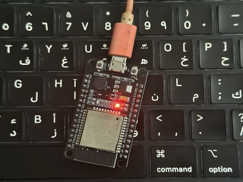
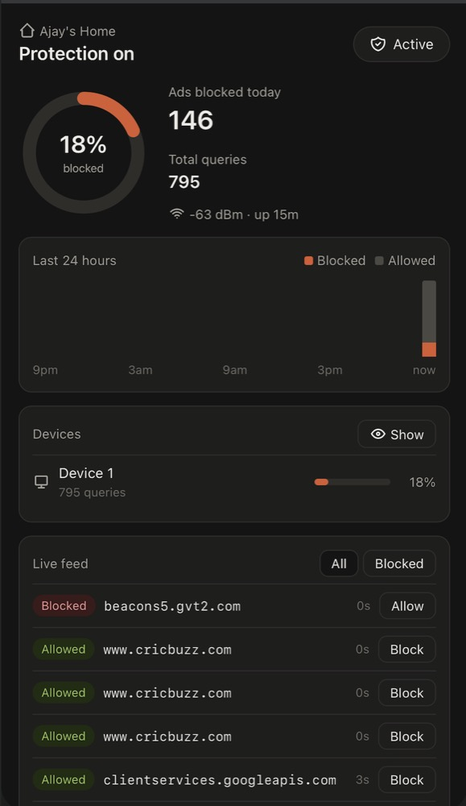

# ESP32 DNS Sinkhole

A small network-wide ad and tracker blocker that runs on a single ESP32 board. It works like Pi-hole: point your router's DNS at the ESP32, and it answers ad and tracker domains with `0.0.0.0` while forwarding everything else to an upstream resolver.



## Features

- Blocks ~130k ad and tracker domains (StevenBlack hosts list) on a 4 MB board
- Blocks subdomains automatically (`ads.example.com` is blocked if `example.com` is listed)
- Web dashboard at `http://sinkhole.local`
  - Block rate, queries today, 24-hour activity chart
  - Per-device block rates, with a hide/show toggle for device names and IPs
  - Live query feed with one-tap Allow / Block
  - Custom allow and block lists, saved on the board
  - Pause / resume blocking
- Password-protected dashboard
- No cloud, no app, no subscription



## Hardware

| Part | Notes |
|---|---|
| ESP32 dev board (ESP-WROOM-32) | Tested on HiLetgo ESP-WROOM-32, 4 MB flash |
| USB data cable | Micro-USB or USB-C depending on the board. Must be a data cable, not charge-only |
| 5V USB power adapter | 1–2 A, for permanent use near the router |

## How it works

```
Device ──DNS query──▶ ESP32 ──┬─ on blocklist ─▶ replies 0.0.0.0
                              └─ allowed ──────▶ forwards to 1.1.1.1 ─▶ reply back to device
```

The blocklist is too large for the ESP32's RAM, so `build_blocklist.py` hashes each domain to 8 bytes and writes a sorted binary file. That file is stored in flash (LittleFS) and each lookup is a binary search, about 17 reads.

## Repository layout

```
esp32_dns_sinkhole/
├── esp32_dns_sinkhole.ino   # firmware: DNS server + web dashboard
├── build_blocklist.py       # builds data/blocklist.bin
└── custom.txt               # optional extra domains to block
docs/
└── flashing-guide.md        # step-by-step setup (macOS)
images/                      # photos and screenshots
```

## Quick start

1. Install Arduino IDE 2.x, the ESP32 board package, and the LittleFS upload plugin.
2. Build the blocklist:
   ```
   cd esp32_dns_sinkhole
   python3 build_blocklist.py
   ```
3. Edit the config block at the top of `esp32_dns_sinkhole.ino`: Wi-Fi name and password (2.4 GHz), static IP, gateway, dashboard password.
4. In Arduino IDE, select **ESP32 Dev Module** and partition scheme **No OTA (1MB APP/3MB SPIFFS)**, then upload the sketch.
5. Upload the `data/` folder with **Upload LittleFS to Pico/ESP8266/ESP32**.
6. Set your router's DHCP DNS to the ESP32's IP.
7. Open `http://sinkhole.local`.

Full instructions are in [docs/flashing-guide.md](docs/flashing-guide.md).

## Configuration

All settings are at the top of the sketch.

| Setting | Purpose |
|---|---|
| `WIFI_SSID`, `WIFI_PASS` | Your 2.4 GHz Wi-Fi network |
| `UI_USER`, `UI_PASS` | Dashboard login |
| `DASHBOARD_NAME` | Title shown on the dashboard |
| `LOCAL_IP`, `GATEWAY`, `SUBNET` | Static IP for the ESP32 |
| `UPSTREAM` | Resolver for allowed queries (default `1.1.1.1`) |
| `TZ_OFFSET_SEC` | Your UTC offset, used for "today" and the 24-hour chart |
| `DEVICES` | Optional friendly names for device IPs |

## Updating the blocklist

Add domains to `custom.txt` (one per line), then:

```
python3 build_blocklist.py
```

and re-upload LittleFS. The sketch itself does not need to be re-flashed. Allow and block entries added from the dashboard are stored separately and survive blocklist uploads.

## Limitations

- **YouTube and some in-app ads** are served from the same domains as the content, so DNS blocking cannot remove them. Use a browser extension such as uBlock Origin alongside this.
- **Encrypted DNS bypasses it.** Turn off "Secure DNS" in browsers, Private Relay on Apple devices, and Private DNS on Android.
- **UDP only, no caching, single upstream.** Fine for a home network.
- **Stats are kept in RAM** and reset when the board restarts.
- Do not port-forward port 53 to the ESP32. It is meant for your local network only.

## License

MIT
